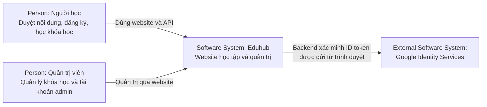
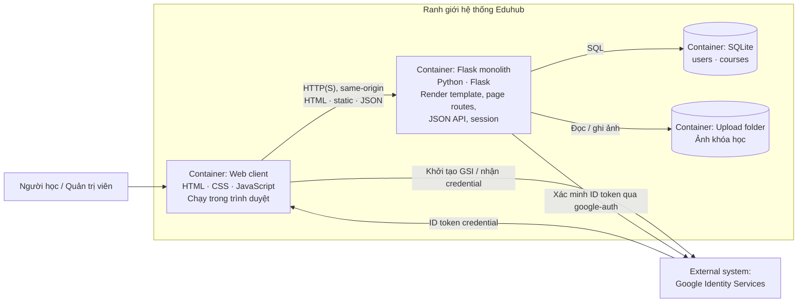
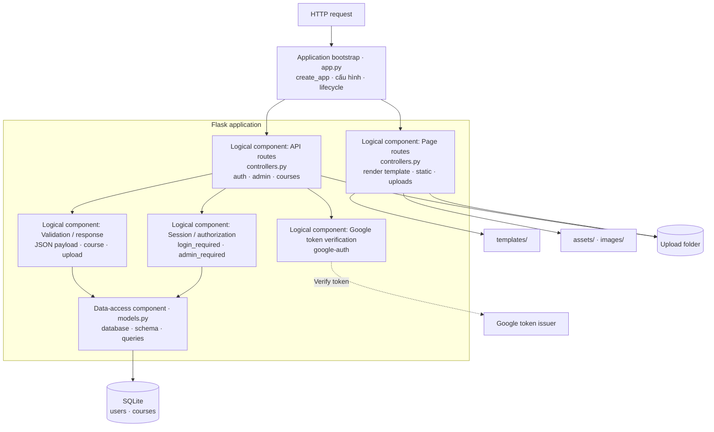
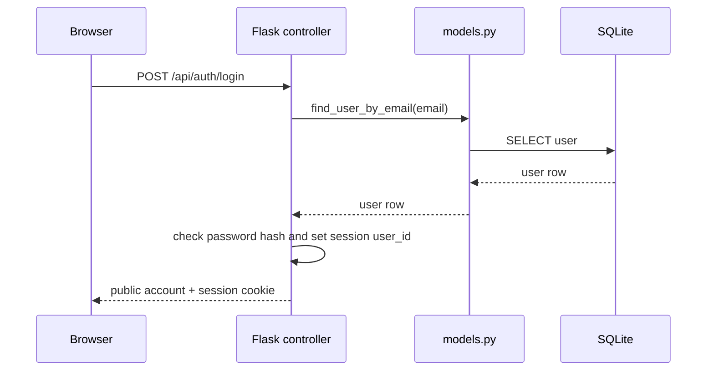
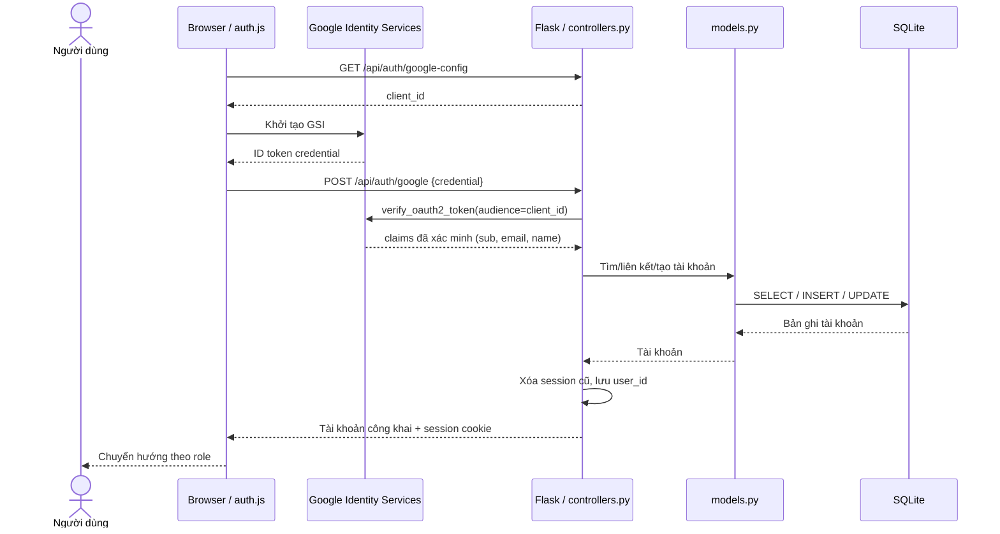
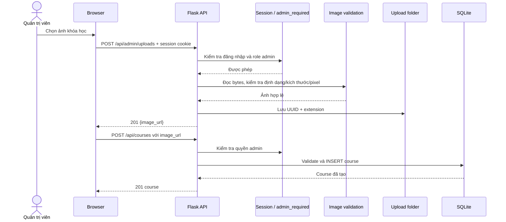
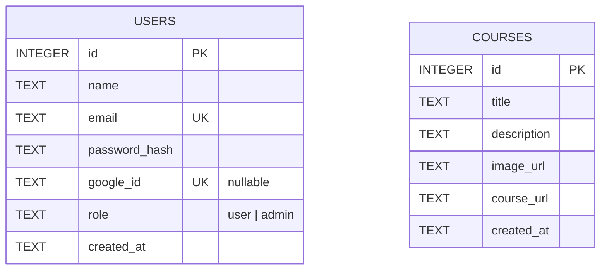
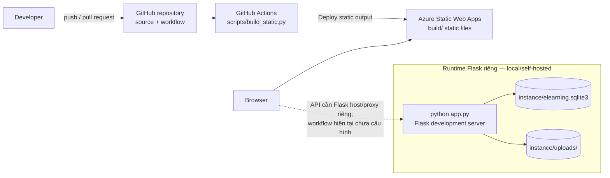
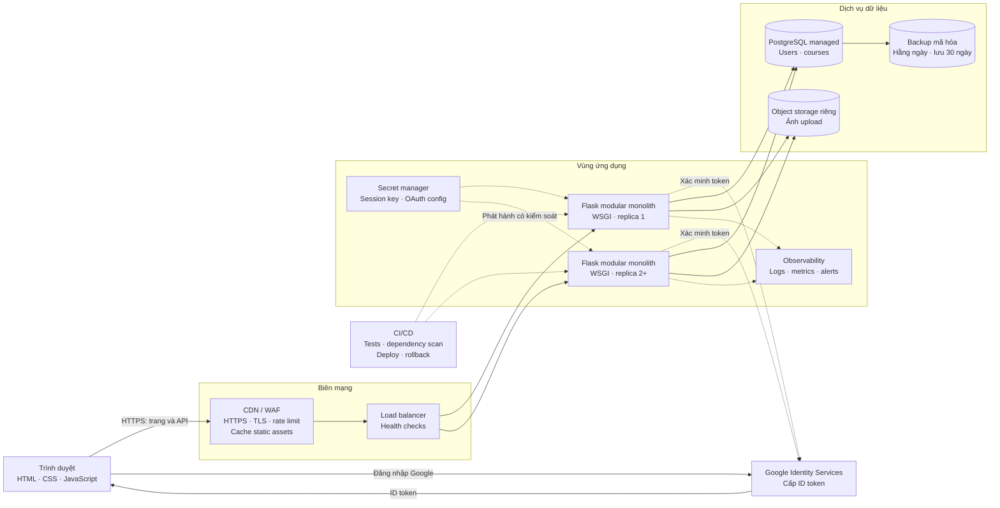

# Kiến trúc phần mềm Eduhub

## 1. Mục đích và phạm vi

Eduhub là ứng dụng học tập gồm các trang nội dung HTML/CSS/JavaScript, API Flask cho tài khoản và quản trị khóa học, và cơ sở dữ liệu SQLite. Tài liệu này mô tả kiến trúc đang có trong mã nguồn; đây không phải thiết kế mục tiêu hay cam kết về cách triển khai production.

Mục tiêu tài liệu là giúp thành viên hiểu ranh giới hệ thống, các luồng chính, cấu trúc dữ liệu, cách triển khai hiện tại và những khoảng trống cần giải quyết trước production.

Các khả năng chính:

- Xem trang chủ, bài viết, khóa học và trang cộng tác viên.
- Đăng ký, đăng nhập, đăng xuất và truy vấn tài khoản hiện tại.
- Đăng nhập Google qua Google Identity Services (GSI) và xác minh ID token ở backend.
- Quản trị viên tạo tài khoản quản trị, quản lý khóa học và tải ảnh khóa học lên.

Tài liệu được tổ chức theo các chủ đề chính của mẫu arc42 và dùng các mức sơ đồ C4 để thể hiện bối cảnh, container và component. Mẫu được áp dụng có chọn lọc: chỉ mô tả những góc nhìn hữu ích cho repository hiện tại, không tạo đủ sơ đồ chỉ để lấp mẫu. Các sơ đồ Mermaid là biểu diễn kiến trúc, không phải ảnh chụp hạ tầng đang chạy.

| Chủ đề arc42 | Vị trí trong tài liệu |
| --- | --- |
| 1. Giới thiệu và mục tiêu | Mục 1 |
| 2. Ràng buộc kiến trúc | Mục 7–10 và 12 |
| 3. Phạm vi và bối cảnh hệ thống | Mục 2 và 5 |
| 4. Chiến lược giải pháp | Mục 2, 10, 12 và 14 |
| 5. Góc nhìn building block | Mục 3 và 6 |
| 6. Góc nhìn runtime | Mục 4 |
| 7. Góc nhìn triển khai | Mục 8 và 14 |
| 8. Khái niệm xuyên suốt | Mục 7 và 9 |
| 9. Quyết định kiến trúc | Mục 10 |
| 10. Yêu cầu chất lượng | Mục 12 và 13 |
| 11. Rủi ro và nợ kỹ thuật | Mục 9 và 10 |
| 12. Thuật ngữ | Mục 16 |

Tham khảo mẫu: [arc42 overview](https://arc42.org/overview), [C4 diagrams](https://c4model.com/diagrams), [C4 system context](https://c4model.com/diagrams/system-context) và [C4 container](https://c4model.com/diagrams/container) (truy cập ngày 12-10-2026).

## 2. Tổng quan kiến trúc

Ứng dụng hiện là một Flask monolith. Các trang và API cùng chạy trong một tiến trình; browser gọi API cùng origin và dùng session cookie do Flask ký để duy trì đăng nhập.

### 2.1 C4 mức 1 — Bối cảnh hệ thống

Sơ đồ cho biết ai sử dụng Eduhub và hệ thống bên ngoài nào tương tác trực tiếp. Google Identity Services là nhà cung cấp bên ngoài; việc trình duyệt nhận ID token và backend xác minh token được thể hiện chi tiết hơn ở các sơ đồ runtime.



### 2.2 C4 mức 2 — Container

Trong C4, “container” là một ứng dụng hoặc kho dữ liệu có ranh giới thực thi/lưu trữ, không đồng nghĩa với Docker. Website client là trình duyệt; backend, database và upload storage được đặt trong ranh giới hệ thống Eduhub. Phần Flask và SQLite dưới đây mô tả cấu hình runtime mặc định trong mã nguồn, không khẳng định Azure Static Web Apps đang chạy backend này.



Google Identity Services cấp credential ở browser; credential được gửi tới Flask và xác minh ở backend bằng `google-auth`. Backend không nhận mật khẩu Google. Dữ liệu ứng dụng được quản lý trong SQLite; ảnh upload được lưu trong thư mục filesystem cấu hình bởi `UPLOAD_FOLDER`.

## 3. Thành phần và trách nhiệm

| Thành phần | Trách nhiệm |
| --- | --- |
| `app.py` | Tạo Flask app, nạp cấu hình môi trường, khởi tạo database, đăng ký blueprint, đóng kết nối theo app context và đặt một số security headers. |
| `controllers.py` | Định nghĩa page/API routes, xác thực session, kiểm tra quyền admin, xác minh Google token, xử lý upload và trả JSON/HTML. |
| `models.py` | Tạo/migrate schema SQLite, seed khóa học mặc định, bootstrap admin, truy vấn và ghi tài khoản/khóa học, kiểm tra dữ liệu khóa học. |
| `templates/` | HTML pages do Flask render; duy trì các URL trang hiện có như `/auth.html` và `/admin.html`. |
| `assets/js/` | Tương tác browser, gọi API same-origin, cập nhật trạng thái trang và xử lý form. `assets/js/auth.js` dùng chung cho trang đăng nhập và các trang cần session. |
| `assets/css/`, `images/` | Stylesheets, biểu tượng và nội dung ảnh tĩnh. |
| `instance/` | Dữ liệu runtime mặc định: SQLite và secret key được tạo tự động. Không nên đưa dữ liệu hoặc secret ở đây vào source control. |
| `instance/uploads/` | Ảnh khóa học đã tải lên theo cấu hình mặc định; có thể chuyển vị trí bằng `UPLOAD_FOLDER`. |
| `scripts/build_static.py` | Sao chép templates và thư mục nội dung/tài nguyên sang `build/` để xuất website tĩnh; không chạy Flask API. |
| `tests/test_app.py` | Kiểm thử API qua Flask test client, database tạm, session, quyền truy cập, upload và URL/trang. |

Các module backend được phân lớp theo trách nhiệm nhưng chưa phải kiến trúc nhiều service hay repository pattern độc lập: controller gọi các hàm data access trong `models.py` trực tiếp.

### 3.1 C4 mức 3 — Component trong ứng dụng Flask

Đây là góc nhìn logic bên trong monolith, không phải các package/service triển khai độc lập. `controllers.py` hiện chứa nhiều trách nhiệm route và nghiệp vụ; các nhóm dưới đây làm rõ vai trò để đọc sơ đồ, không hàm ý đã tách module.



## 4. Luồng xử lý chính

### 4.1 Đăng nhập email/mật khẩu

1. Browser gửi email và mật khẩu tới `POST /api/auth/login`.
2. Controller chuẩn hóa email, tìm tài khoản và so khớp password hash bằng Werkzeug.
3. Nếu hợp lệ, controller xóa session cũ, đánh dấu session permanent và lưu `user_id`.
4. Flask trả thông tin tài khoản công khai; browser điều hướng theo role.
5. Request tiếp theo gửi session cookie. `login_required` nạp tài khoản từ SQLite và gắn nó vào Flask `g` cho request hiện tại.



### 4.2 Đăng nhập Google

1. Trang auth lấy `client_id` từ `GET /api/auth/google-config` và khởi tạo GSI.
2. GSI trả credential (ID token) qua callback JavaScript.
3. Browser gửi credential tới `POST /api/auth/google`.
4. Backend xác minh token với Google audience là `GOOGLE_CLIENT_ID`, rồi lấy `sub`, email và tên.
5. Backend liên kết theo Google subject đã lưu hoặc theo email hiện hữu; nếu chưa có tài khoản thì tạo tài khoản role `user`.
6. Backend tạo session giống đăng nhập thường và trả tài khoản công khai.

Nếu chưa cấu hình client ID, trang hiển thị thông báo cấu hình và vô hiệu hóa riêng nút Google; form email/mật khẩu vẫn dùng được. Việc đăng nhập Google thực tế còn phụ thuộc cấu hình OAuth client (origin được phép, client ID) tại Google Cloud.



### 4.3 Quản trị khóa học

API đọc danh sách khóa học là công khai. Tạo, cập nhật, xóa khóa học và upload ảnh đều đi qua `admin_required`, kiểm tra session rồi kiểm tra role `admin`. Dữ liệu khóa học được validate ở backend trước khi ghi SQLite. Ảnh upload được kiểm tra định dạng, giới hạn 5 MB và giới hạn kích thước pixel; tên lưu file được tạo bằng UUID.



## 5. API và quyền truy cập

| Method | Endpoint | Quyền | Mục đích |
| --- | --- | --- | --- |
| `GET` | `/api/auth/me` | Đăng nhập | Lấy tài khoản hiện tại. |
| `GET` | `/api/auth/google-config` | Công khai | Lấy Google client ID phục vụ khởi tạo GSI. |
| `POST` | `/api/auth/register` | Công khai | Tạo tài khoản học viên; role luôn là `user`. |
| `POST` | `/api/auth/login` | Công khai | Đăng nhập bằng email/mật khẩu. |
| `POST` | `/api/auth/google` | Công khai, token phải hợp lệ | Đăng nhập/tạo liên kết tài khoản Google. |
| `POST` | `/api/auth/logout` | Công khai | Xóa session hiện tại. |
| `GET` | `/api/courses` | Công khai | Liệt kê khóa học. |
| `POST` | `/api/courses` | Admin | Tạo khóa học. |
| `PUT` | `/api/courses/<id>` | Admin | Cập nhật khóa học. |
| `DELETE` | `/api/courses/<id>` | Admin | Xóa khóa học. |
| `POST` | `/api/admin/uploads` | Admin | Tải ảnh khóa học lên. |
| `GET` | `/api/admin/users` | Admin | Liệt kê tài khoản. |
| `POST` | `/api/admin/users` | Admin | Tạo tài khoản admin. |

API nhận/trả JSON cho các thao tác tài khoản và khóa học. Payload không phải object JSON được chuẩn hóa thành object rỗng và được xử lý như dữ liệu không hợp lệ.

## 6. Mô hình dữ liệu và lưu trữ

### `users`

| Cột | Ý nghĩa |
| --- | --- |
| `id` | Khóa chính số nguyên tăng tự động. |
| `name` | Tên hiển thị. |
| `email` | Email duy nhất, so sánh không phân biệt hoa/thường. |
| `password_hash` | Password hash do Werkzeug tạo; không lưu mật khẩu dạng rõ. |
| `google_id` | Google subject (`sub`), duy nhất khi có giá trị; cho phép liên kết với đăng nhập Google. |
| `role` | `user` hoặc `admin`, được giới hạn bởi CHECK constraint. |
| `created_at` | Thời điểm tạo, mặc định theo SQLite. |

### `courses`

| Cột | Ý nghĩa |
| --- | --- |
| `id` | Khóa chính số nguyên tăng tự động. |
| `title`, `description` | Tên và mô tả khóa học. |
| `image_url` | Đường dẫn ảnh nội bộ hoặc URL ảnh hợp lệ. |
| `course_url` | Liên kết nội dung khóa học, chỉ chấp nhận HTTP/HTTPS. |
| `created_at` | Thời điểm tạo. |

SQLite mặc định ở `instance/elearning.sqlite3`, có thể thay bằng `DATABASE_PATH`. Khóa học mặc định được thêm khi bảng `courses` rỗng. `initialize_database()` cũng bổ sung cột Google ID cho database cũ và tạo unique index.



`users` và `courses` hiện không có quan hệ khóa ngoại với nhau. URL ảnh có thể trỏ tới tài nguyên nội bộ, ảnh upload hoặc URL HTTP(S); `course_url` chỉ chấp nhận HTTP(S).

## 7. Cấu hình và khởi động

Ứng dụng chạy bằng `python app.py`, mặc định bind `127.0.0.1:5000`; biến `PORT` thay đổi port. Các biến cấu hình được sử dụng:

| Biến | Mục đích |
| --- | --- |
| `SECRET_KEY` | Khóa ký Flask session. Nếu bỏ trống, app tạo/lưu khóa trong `instance/secret_key`. |
| `DATABASE_PATH` | Vị trí file SQLite. |
| `UPLOAD_FOLDER` | Vị trí lưu ảnh upload. |
| `ADMIN_EMAIL`, `ADMIN_PASSWORD` | Bootstrap admin ban đầu; phải đặt cùng nhau. Admin chỉ được tạo nếu email chưa có tài khoản. |
| `GOOGLE_CLIENT_ID` | Client ID OAuth dùng cho GSI và xác minh ID token ở backend. |
| `SESSION_COOKIE_SECURE` | Khi bằng `true`, chỉ gửi session cookie qua HTTPS. |
| `PORT` | Cổng HTTP của Flask development server. |

Dependencies runtime chính: Flask, Pillow và google-auth; phiên bản được giới hạn trong `requirements.txt`.

## 8. Trang, static assets và triển khai

- `/` render `templates/index.html`; `/auth.html` render trang xác thực.
- Các đường dẫn `.html` khác được render từ `templates/`; file CSS/JS/ảnh được phục vụ từ thư mục dự án nếu phần mở rộng nằm trong allowlist.
- Ảnh upload được phục vụ riêng dưới `/uploads/<filename>` sau kiểm tra tên và phần mở rộng.
- `scripts/build_static.py` sao chép templates, assets, images và một số nhóm nội dung sang thư mục build. Lệnh export không tạo backend, API, database hay lưu trữ upload.
- Workflow Azure Static Web Apps hiện có chỉ triển khai static files. Để dùng đăng nhập, quản trị và upload, cần host Python-capable cho Flask cùng lưu trữ bền vững cho SQLite và uploads.
- Flask server tích hợp trong `app.py` là development server; môi trường production cần WSGI server/reverse proxy, HTTPS và nơi lưu dữ liệu bền vững.

### 8.1 Góc nhìn triển khai hiện tại

Repository có workflow tự động xuất và triển khai static site lên Azure Static Web Apps. Backend Flask được khởi động riêng bằng `python app.py`; workflow hiện tại không build hoặc deploy tiến trình Flask, SQLite hay thư mục upload. Vì vậy việc xuất/deploy static không đồng nghĩa với việc toàn bộ API và chức năng đăng nhập/quản trị đang hoạt động trên cùng host.



### 8.2 Góc nhìn triển khai mục tiêu

Sơ đồ production chi tiết được trình bày tại [mục 14](#14-kiến-trúc-mục-tiêu-production); đây là đề xuất, không phải tài nguyên đã được cấu hình trong repository.

## 9. Bảo mật và giới hạn hiện tại

- Password được hash; dữ liệu tài khoản trả về client đi qua `public_account()` để loại password hash.
- Phân quyền admin được thực hiện ở backend, không chỉ dựa vào ẩn/hiện giao diện.
- Session cookie được cấu hình `HttpOnly` và `SameSite=Lax`; bật `SESSION_COOKIE_SECURE=true` khi chạy sau HTTPS.
- Google ID token được xác minh phía server với audience là client ID cấu hình.
- Upload kiểm tra nội dung ảnh bằng Pillow, giới hạn kích thước file và số pixel; không tin tên file do người dùng gửi.
- Khóa ký mặc định được lưu trong `instance`; triển khai nhiều worker/host cần dùng cùng `SECRET_KEY` ổn định.
- Backend hiện dùng SQLite đồng bộ và một file database; cần đánh giá lại backup, concurrent writes và migration khi quy mô tăng.
- Các API thay đổi dữ liệu dựa trên session cookie hiện chưa có CSRF token riêng. Nếu triển khai ra môi trường có rủi ro cross-site cao, cần bổ sung biện pháp CSRF phù hợp và kiểm thử.
- Google config endpoint có thể trả chuỗi rỗng khi chưa thiết lập `GOOGLE_CLIENT_ID`; điều đó không ngăn đăng nhập thường.

## 10. Quyết định kiến trúc và giới hạn đã biết

| ID | Quyết định / giới hạn | Lý do và hệ quả |
| --- | --- | --- |
| ADR-01 | Dùng Flask monolith thay vì tách microservice. | Phù hợp phạm vi dự án hiện tại, giảm vận hành phân tán; module backend có thể tiếp tục tách nội bộ khi trách nhiệm/codebase tăng. |
| ADR-02 | Dùng SQLite và filesystem cho cấu hình mặc định. | Đơn giản cho local/dev/demo; backup, concurrent writes và scale nhiều instance cần giải quyết trước production. |
| ADR-03 | Azure Static Web Apps workflow hiện chỉ deploy static output. | Tận dụng pipeline static hiện có; không cung cấp Flask API, database hoặc upload runtime. Cần host/proxy riêng nếu cần chức năng backend. |
| ADR-04 | Dùng Flask signed-cookie session, giữ `user_id` trong session. | Không cần session store riêng cho cấu hình đơn giản; mọi replica phải dùng cùng `SECRET_KEY`. Cookie session không thay thế CSRF protection. |

Các rủi ro ưu tiên cần theo dõi:

| Rủi ro | Tác động | Hướng xử lý |
| --- | --- | --- |
| API thay đổi dữ liệu chưa có CSRF token riêng. | Request cross-site có thể lợi dụng session của người dùng trong một số điều kiện triển khai. | Bổ sung CSRF protection phù hợp hoặc cơ chế xác thực thay thế; kiểm thử các endpoint thay đổi dữ liệu. |
| Database và ảnh nằm trên filesystem cục bộ mặc định. | Mất dữ liệu khi host ephemeral; không chia sẻ dữ liệu giữa replicas. | Chọn persistent storage, lập backup/restore và thử nghiệm trước khi scale. |
| Build/deploy static tách rời Flask runtime. | UI có thể được publish trong khi API/auth chưa được triển khai hoặc định tuyến cùng origin. | Quy định kiến trúc hosting, API origin/proxy, CORS/cookie và pipeline backend trước phát hành. |
| Chưa có benchmark, telemetry và health checks được ghi nhận. | Khó xác nhận mục tiêu hiệu năng/sẵn sàng hoặc phát hiện suy giảm. | Thiết lập profile tải, health/readiness checks, metrics và cảnh báo. |

## 11. Kiểm thử

Backend được kiểm thử bằng unittest và Flask test client. Test tạo database/upload folder tạm, kiểm tra đăng ký/đăng nhập, session, phân quyền, CRUD khóa học, upload ảnh, URL trang và phản hồi API. Chạy bộ test:

```powershell
python -m unittest discover -s tests -v
```

Kiểm thử đăng nhập Google hiện có xác minh luồng account/session với hàm kiểm tra ID token được mock; việc xác minh chữ ký thực và OAuth end-to-end cần Google OAuth client cùng credential hợp lệ.

## 12. Yêu cầu kiến trúc và mức độ đáp ứng

Các yêu cầu dưới đây được đối chiếu với mã nguồn tại thời điểm viết tài liệu. “Đã có” mô tả hành vi nhìn thấy trong mã, không thay thế cho kiểm thử triển khai hoặc kiểm định bảo mật độc lập.

| Nhóm | Yêu cầu | Hiện trạng |
| --- | --- | --- |
| Cấu trúc | Giữ ứng dụng Flask monolith; phân tách khởi tạo ứng dụng, route, truy cập dữ liệu và giao diện. | Đã có: `app.py`, `controllers.py`, `models.py`, `templates/` và `assets/` có trách nhiệm riêng. Đây chưa phải kiến trúc microservice. |
| Cấu trúc | Các route dùng chung quy tắc nhận/trả JSON và xử lý lỗi đầu vào rõ ràng. | Đã có helper chuẩn hóa lỗi JSON; payload không phải object được xem như object rỗng để validation của route trả lỗi. |
| Dữ liệu | Đưa truy vấn và thao tác dữ liệu dùng chung qua các hàm trong `models.py`, hạn chế SQL trong route. | Đạt một phần: phần lớn thao tác đi qua hàm model; luồng liên kết tài khoản Google vẫn thực hiện câu `UPDATE` trực tiếp trong controller. |
| Bảo mật | Hash mật khẩu, không trả `password_hash`, kiểm tra quyền quản trị ở backend. | Đã có: Werkzeug password hash, `public_account()` và decorator `admin_required`. |
| Bảo mật | Xác minh ID token Google ở backend theo audience cấu hình. | Đã có trong mã; test hiện mock hàm xác minh, chưa chứng minh OAuth end-to-end. |
| Bảo mật | Bảo vệ session cookie và bí mật triển khai. | Đã cấu hình `HttpOnly`, `SameSite=Lax`; `Secure` bật theo `SESSION_COOKIE_SECURE`. Khóa mặc định được tạo trong `instance/`; production cần cấu hình bí mật ổn định bên ngoài source control. |
| Bảo mật | Bảo vệ endpoint thay đổi dữ liệu khỏi CSRF và lạm dụng đăng nhập. | Chưa có CSRF token hoặc giới hạn thử đăng nhập riêng trong mã hiện tại; cần xử lý trước khi coi hệ thống sẵn sàng production. |
| Upload | Kiểm tra nội dung ảnh, giới hạn kích thước và không dùng tên do người dùng cung cấp làm tên lưu. | Đã có kiểm tra định dạng/kích thước ảnh và tên UUID; API giới hạn ảnh ở 5 MB, Flask giới hạn request ở 6 MB. |
| Vận hành dữ liệu | Có lưu trữ bền vững, migration có kiểm soát, sao lưu và khôi phục. | Chưa có pipeline sao lưu/khôi phục; database và ảnh mặc định lưu trên filesystem cục bộ. Khởi tạo schema chỉ xử lý một thay đổi tương thích cụ thể là bổ sung `google_id`. |

## 13. Yêu cầu phi chức năng

Các ngưỡng dưới đây là baseline nghiệm thu đề xuất cho production quy mô nhỏ đến vừa, không phải kết quả benchmark hoặc SLA hiện có. Nhóm cần thống nhất profile tải, môi trường và công cụ đo trước khi dùng các con số này làm tiêu chí phát hành.

| Thuộc tính | Mục tiêu đề xuất | Bằng chứng / khoảng trống hiện tại |
| --- | --- | --- |
| Hiệu năng API | Với 100 người dùng đồng thời và 10 request/giây trong 15 phút: p95 không quá 500 ms cho đọc, 800 ms cho ghi; lỗi 5xx dưới 1%. Không tính thời gian phụ thuộc Google. | Chưa có benchmark hoặc kết quả đo trong repository. Cần kiểm thử tải trên môi trường gần production. |
| Hiệu năng giao diện | LCP p75 không quá 2,5 giây cho trang chủ, đăng nhập và danh sách khóa học trên profile thiết bị/mạng đã thống nhất. | Chưa có kiểm thử Lighthouse/RUM được ghi nhận. |
| Tính sẵn sàng | Mục tiêu 99,5% theo tháng, đo bằng kiểm tra tổng hợp bên ngoài. | Chưa có giám sát uptime hoặc SLA được cấu hình trong repository. |
| Bảo mật | HTTPS/TLS 1.2 trở lên; cookie `Secure`, `HttpOnly`, `SameSite`; CSRF cho thao tác thay đổi dữ liệu dùng cookie; kiểm tra quyền backend; bí mật từ secret manager. Mục tiêu tham chiếu OWASP ASVS Level 2. | Mã hiện có một số kiểm soát ở ứng dụng; HTTPS, secret manager, CSRF, giới hạn đăng nhập và kiểm định ASVS cần được triển khai/kiểm chứng tại môi trường đích. |
| Toàn vẹn dữ liệu | Email chuẩn hóa và duy nhất; kiểm soát vai trò bằng constraint; schema thay đổi có migration; không ghi password, token hoặc secret vào log. | Có unique email, role constraint và truy vấn tham số hóa trong schema/queries hiện tại. Chưa có hệ thống migration hoặc kiểm thử log được ghi nhận. |
| Sao lưu và khôi phục | RPO không quá 24 giờ, RTO không quá 4 giờ; backup mã hóa hằng ngày, lưu tối thiểu 30 ngày. | Đây là mục tiêu đề xuất. Chưa có cơ chế backup tự động hoặc diễn tập restore trong repository. |
| Mở rộng | Tối thiểu 2 replica stateless, có thể tăng đến 4 replica; session, database và ảnh không phụ thuộc filesystem cục bộ. | Kiến trúc hiện tại dùng SQLite và upload cục bộ; chưa phù hợp scale ngang nếu không bổ sung lưu trữ dùng chung và xác minh session key/cấu hình đồng nhất. |
| Quan sát | Health/readiness check; log có cấu trúc và request ID; dashboard latency, lỗi, database và tài nguyên; cảnh báo theo ngưỡng đã thống nhất. | Chưa thấy triển khai health check hoặc telemetry trong mã nguồn hiện tại. |
| Tương thích và tiếp cận | Hỗ trợ hai phiên bản ổn định gần nhất của Chrome, Edge, Firefox, Safari; giao diện từ 360 px; mục tiêu WCAG 2.2 AA cho luồng đăng nhập và học nội dung. | Chưa có ma trận trình duyệt hoặc báo cáo accessibility được ghi nhận. |
| Triển khai và phục hồi | CI chạy test và kiểm tra dependency; có health check sau deploy, rollback ứng dụng trong 10 phút; migration tương thích ngược hoặc có phương án phục hồi đã thử. | Workflow Azure Static Web Apps hiện export và deploy static files; chưa triển khai Flask backend hoặc pipeline production nêu trên. |

### 13.1. Ưu tiên triển khai

1. **Bảo mật:** bổ sung CSRF phù hợp với session cookie, giới hạn thử đăng nhập, rà soát cấu hình HTTPS/cookie và quản lý secret.
2. **Dữ liệu:** quyết định nơi lưu trữ bền vững cho database và ảnh; xây dựng backup/restore và migration có kiểm soát.
3. **Kiểm thử:** mở rộng test cho input lỗi, quyền truy cập, upload không hợp lệ, migration và lỗi phụ thuộc; bổ sung test browser/OAuth thực tế khi có cấu hình.
4. **Đo lường:** thống nhất profile tải và thiết lập benchmark/API, Lighthouse hoặc RUM trước khi công bố mục tiêu hiệu năng.
5. **Mở rộng:** chỉ chuyển database hoặc tách thành phần khi số liệu tải, yêu cầu sẵn sàng hoặc yêu cầu vận hành chứng minh cần thiết; chưa có lý do hiện tại để thêm microservice, Redis hoặc message broker.

### 13.2. Tiêu chí nghiệm thu đề xuất

- Các luồng đăng ký, đăng nhập thường, đăng nhập Google, đăng xuất, quản lý khóa học và upload được kiểm thử.
- Tài khoản không có quyền không thể gọi thành công endpoint admin; phản hồi không chứa password hash hoặc bí mật.
- Upload từ chối dữ liệu không phải ảnh, ảnh quá lớn và loại nội dung không được hỗ trợ.
- Các ngưỡng hiệu năng được đo và lưu cùng profile/môi trường, không chỉ xác nhận bằng mô tả.
- Có hướng dẫn vận hành triển khai, giám sát, backup, restore và rollback.
- Rủi ro chưa xử lý như CSRF, lưu trữ cục bộ, giới hạn SQLite và OAuth chưa được kiểm thử end-to-end được ghi nhận trước phát hành.

## 14. Kiến trúc mục tiêu production

Sơ đồ sau là định hướng triển khai, không phải trạng thái đã có. Ứng dụng vẫn là modular monolith Flask; phần production đề xuất chuyển database sang PostgreSQL managed và ảnh upload sang object storage bền vững. Hai hoặc nhiều replica chỉ khả thi sau khi session key, cấu hình, database và file upload không còn phụ thuộc vào đĩa cục bộ của từng replica.



CDN chỉ cache tài nguyên tĩnh, không cache API cá nhân hoặc phản hồi có session. SQLite và upload trên filesystem vẫn phù hợp cho phát triển/demo đơn máy; chuyển sang PostgreSQL/object storage chỉ nên thực hiện cùng migration, kiểm thử dữ liệu và diễn tập restore. Không đưa thêm cache phân tán hoặc service riêng khi chưa có nhu cầu đo được.

## 15. Kết luận

Eduhub hiện là Flask monolith với giao diện HTML/CSS/JavaScript, API same-origin, session cookie, SQLite và thư mục upload cục bộ. Kiến trúc này phù hợp cho phạm vi hiện tại và đã có các kiểm soát cơ bản cho password, phân quyền admin, xác minh Google ID token và upload ảnh.

Để đáp ứng mục tiêu production, cần xử lý các khoảng trống về CSRF, giới hạn đăng nhập, quản lý secret, lưu trữ bền vững, migration, backup/restore, giám sát và kiểm thử hiệu năng. Mọi chỉ tiêu ở phần phi chức năng và sơ đồ production là mục tiêu đề xuất cần triển khai, đo lường và nghiệm thu riêng; không nên hiểu là năng lực đã được mã nguồn hoặc môi trường hiện tại bảo đảm.

## 16. Thuật ngữ

| Thuật ngữ | Ý nghĩa trong tài liệu |
| --- | --- |
| Monolith | Một ứng dụng backend được đóng gói/chạy như một đơn vị; các module bên trong vẫn có thể tách theo trách nhiệm. |
| C4 container | Một ứng dụng hoặc kho dữ liệu có ranh giới trách nhiệm/thực thi; không nhất thiết là container Docker. |
| Component | Nhóm trách nhiệm logic bên trong một container. Sơ đồ component không khẳng định nhóm đó đã được tách thành package/module độc lập. |
| GSI | Google Identity Services; cung cấp trải nghiệm đăng nhập và credential ở trình duyệt. |
| ID token | Token nhận diện danh tính do nhà cung cấp cấp; backend phải xác minh trước khi tin các claims. |
| Same-origin | Trang và API được truy cập dưới cùng scheme, host và port của trình duyệt. |
| RPO | Mức mất dữ liệu tối đa chấp nhận được tính theo thời gian. |
| RTO | Thời gian tối đa mục tiêu để khôi phục dịch vụ sau gián đoạn. |
| WSGI | Giao diện chuẩn để chạy ứng dụng Python web sau web server/WSGI server trong triển khai production. |