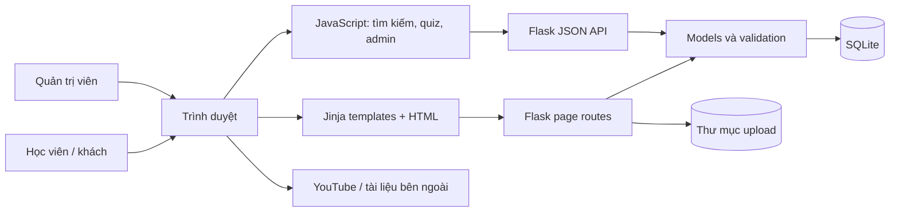

# Thuyết minh và kiến trúc Eduhub

## 1. Tổng quan

Eduhub là website hỗ trợ người học tìm và sử dụng tài nguyên lập trình. Người học có thể duyệt khóa học, sách/tài liệu, mở trang chi tiết, làm quiz và xem kết quả. Quản trị viên quản lý nội dung và theo dõi thống kê quiz.

### Mục tiêu

1. Tập trung tài nguyên học lập trình trong một giao diện có thể tìm kiếm.
2. Cung cấp thông tin trước khi người học mở video hoặc tài liệu bên ngoài.
3. Tách quyền học viên và quản trị viên để bảo vệ các thao tác quản lý.
4. Lưu nội dung và kết quả quiz ở server để dùng chung giữa các trình duyệt.

### Phạm vi hiện tại

- Nội dung khóa học, sách và tài khoản được lưu trong SQLite.
- Video và tài liệu học được liên kết tới dịch vụ bên ngoài; Eduhub không lưu hoặc phát video.
- Bộ câu hỏi quiz mẫu nằm trong JavaScript; lượt nộp bài được gửi lên Flask và lưu trong SQLite.
- Quản lý danh mục đề quiz hiện lưu trong `localStorage`; đây chưa phải công cụ biên soạn đề nhiều người dùng trên server.

## 2. Kiến trúc tổng thể



### Các lớp

| Lớp | Trách nhiệm |
|---|---|
| Browser | Render trang, tìm kiếm/lọc, thao tác quiz, gửi request và hiển thị kết quả |
| Templates | Trang Jinja được server render; gồm trang chủ, admin và chi tiết khóa học/sách |
| Controllers | Định tuyến, xác thực session, kiểm tra quyền, validation request và response |
| Models | Khởi tạo schema, truy vấn SQLite, kiểm tra dữ liệu và lưu các thực thể |
| SQLite | Lưu tài khoản, khóa học, sách và lượt làm quiz |
| Upload storage | Lưu ảnh khóa học và ảnh bìa sách đã xác thực định dạng/kích thước |

`app.py` tạo Flask app, nạp cấu hình, khởi tạo database, đóng kết nối theo request và đăng ký page/API blueprints.

## 3. Mô hình dữ liệu

### `users`

- `id`: khóa chính.
- `name`, `email`: thông tin tài khoản; email duy nhất và không phân biệt hoa/thường.
- `password_hash`: hash mật khẩu do Werkzeug tạo, không lưu mật khẩu thuần.
- `role`: `user` hoặc `admin`.
- `created_at`: thời điểm tạo.

### `courses`

- `id`, `title`, `description`, `details`.
- `image_url`: đường dẫn ảnh local/upload hoặc URL HTTP(S) đã validation.
- `course_url`: URL video/playlist bên ngoài.
- `created_at`.

### `books`

- `id`, `title`, `author`, `category`, `description`, `details`.
- `cover_image`: đường dẫn ảnh bìa upload.
- `document_url`: URL tài liệu bên ngoài.
- `created_at`.

### `quiz_attempts`

- `id`, `exam_id`, `exam_title`, `subject`.
- `user_id`: liên kết tới tài khoản nếu người nộp đã đăng nhập; lượt khách có thể không gắn user.
- `correct_count`, `total_questions`, `score`, `duration_seconds`.
- `created_at`.

Các trường `details` được bổ sung bằng migration `ALTER TABLE` khi khởi động, vì vậy database tạo từ phiên bản cũ được giữ dữ liệu hiện có.

## 4. Luồng nghiệp vụ chính

### Duyệt khóa học và sách

1. Flask render danh mục sách từ SQLite; JavaScript tải khóa học từ `GET /api/courses`.
2. Thanh tìm kiếm chung lọc tiêu đề/mô tả khóa học, tên/tác giả sách và cung cấp lối tắt quiz.
3. Trang chủ hiển thị bốn mục đầu tiên. “Xem thêm” hiển thị phần còn lại; “Thu gọn” trở về danh sách ban đầu.
4. Nút chi tiết mở `/courses/<id>` hoặc `/books/<id>`; trang chi tiết lấy nội dung từ database.
5. CTA riêng mở URL YouTube hoặc tài liệu sau khi người học đã xem thông tin.

### Quản lý nội dung

1. Admin đăng nhập qua `/login`.
2. Các trang sách ở `/admin/books`; khóa học được quản lý từ trang admin tương ứng.
3. Request quản trị được kiểm tra session và role `admin` ở server.
4. Dữ liệu được validate trước khi insert/update; ảnh upload giới hạn định dạng và kích thước.

### Làm quiz và xem thống kê

1. Bộ câu hỏi được nạp từ question bank trong `assets/js/quiz.js`.
2. Khi nộp bài, trình duyệt tính số câu đúng và gửi kết quả tới `POST /api/quiz/attempts`.
3. Server kiểm tra giới hạn dữ liệu và tự tính lại score từ số câu đúng/tổng câu trước khi lưu.
4. `GET /api/admin/quiz/statistics` chỉ cho admin truy cập; API tổng hợp lượt thi, điểm trung bình, số user đã đăng nhập, độ chính xác, số liệu theo đề và 20 kết quả gần nhất.

## 5. Các tuyến quan trọng

| Tuyến | Mục đích | Quyền |
|---|---|---|
| `/` và `/index.html` | Trang chủ và thư viện | Công khai |
| `/courses/<id>` | Chi tiết khóa học | Công khai |
| `/books/<id>` | Chi tiết sách | Công khai |
| `/api/auth/register` | Tạo tài khoản học viên | Công khai |
| `/api/auth/login`, `/api/auth/logout`, `/api/auth/me` | Session tài khoản | Tùy thao tác |
| `/api/courses` | Đọc danh sách khóa học | GET công khai |
| `POST /api/courses`, `PUT/DELETE /api/courses/<id>` | Quản lý khóa học | Admin |
| `/admin/books/*` | Thêm/sửa/xóa sách | Admin |
| `/api/quiz/attempts` | Ghi nhận lượt quiz | Công khai; có thể gắn user session |
| `/api/admin/quiz/statistics` | Báo cáo quiz tổng hợp | Admin |

## 6. Bảo mật và độ tin cậy

- Password hash được dùng thay vì lưu mật khẩu nguyên văn.
- Session cookie bật `HttpOnly` và `SameSite=Lax`; `Secure` có thể bật bằng `SESSION_COOKIE_SECURE=true` khi triển khai HTTPS.
- Route quản trị kiểm tra quyền ở server; ẩn nút trên giao diện không phải cơ chế bảo vệ.
- SQL dùng parameterized queries cho dữ liệu request.
- Ảnh upload được mở/xác minh bằng Pillow, giới hạn kích thước 5 MB và giới hạn số pixel.
- HTML động phía client dùng `textContent` hoặc escape dữ liệu trước khi render.
- `SECRET_KEY`, mật khẩu admin và database path có thể cấu hình qua biến môi trường.

## 7. Kiểm thử

Kiểm thử tích hợp trong `tests/test_app.py` tạo database và thư mục upload tạm cho từng test. Các nhóm kiểm thử gồm:

- đăng ký/đăng nhập, session và quyền admin;
- CRUD khóa học và sách, nội dung chi tiết và trang 404;
- upload ảnh hợp lệ/không hợp lệ, dung lượng và đường dẫn;
- trang tĩnh và asset;
- ghi nhận kết quả quiz, tổng hợp báo cáo và từ chối truy cập không đủ quyền.

Chạy bằng:

```powershell
python -m unittest discover -s tests -v
```

## 8. Giới hạn và hướng phát triển

- Quiz hiện có question bank mẫu cố định; công cụ admin quản lý danh mục đề vẫn dựa trên trình duyệt.
- Lượt quiz của khách được lưu nhưng không được tính vào số tài khoản học viên duy nhất.
- Tài liệu và video mở ở dịch vụ ngoài; chưa có player, theo dõi tiến độ hoặc cấp quyền truy cập nội dung.
- Cần bổ sung CSRF protection, rate limiting và logging/monitoring trước khi mở rộng cho production.
- Có thể phát triển tiếp: trình biên soạn câu hỏi phía server, phân trang dữ liệu, export báo cáo, kiểm thử UI tự động và quản lý tiến độ học.

## 9. Triển khai

Ứng dụng hiện được kiểm thử với Flask development server. Môi trường production cần WSGI server, HTTPS, secret riêng, admin credentials riêng, database và upload storage persistent. Workflow Azure Static Web Apps chỉ đóng gói giao diện tĩnh, không thay thế backend Flask hoặc SQLite.