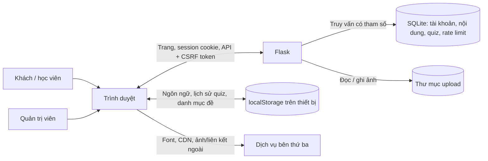

# Bảo mật và quyền riêng tư

## Mục đích và phạm vi

Tài liệu này ghi nhận luồng dữ liệu, ranh giới tin cậy và rủi ro nhìn thấy trong mã nguồn Eduhub. Thời hạn dưới đây mô tả cấu hình/chính sách hiện tại; việc thực thi còn phụ thuộc tác vụ vận hành và nhà cung cấp hosting. Chi tiết vòng đời tài khoản, quiz và backup ở [privacy-data-lifecycle.md](./privacy-data-lifecycle.md).

## Luồng dữ liệu và ranh giới tin cậy



Tin cậy không được mặc định giữa trình duyệt và Flask, giữa Flask và SQLite/upload storage, hoặc giữa Eduhub và bên thứ ba. CSRF token bảo vệ request thay đổi trạng thái dùng session cookie; dữ liệu quiz từ trình duyệt vẫn là đầu vào không đáng tin cậy. `localStorage` nằm ngoài quyền xóa của máy chủ.

## Dữ liệu, mục đích, quyền truy cập và lưu giữ

| Dữ liệu | Mục đích / nơi lưu | Ai truy cập | Hiện trạng lưu giữ |
|---|---|---|---|
| Tên, email, vai trò, password hash | Tài khoản và xác thực; SQLite `users`. Mật khẩu thuần không lưu. | Chủ tài khoản xem/xuất dữ liệu của mình; admin quản lý tài khoản; backend xác thực. | Đến khi tài khoản bị xóa. Người dùng có thể xuất tại `GET /api/auth/me/data` và xóa tại `DELETE /api/auth/me`; lượt quiz liên quan được gộp thành tổng hợp. |
| Session đăng nhập | Cookie Flask có chữ ký, `HttpOnly`, `SameSite=Lax`; chứa `user_id` và trạng thái permanent, không chứa mật khẩu. Chữ ký không mã hóa nội dung. | Trình duyệt gửi cookie; Flask xác thực và phân quyền. | Tối đa 30 ngày. `Secure` tự bật trong `APP_ENV=production`; cần HTTPS ở hosting. |
| Lượt quiz chi tiết | SQLite `quiz_attempts`: đề, môn, điểm, thời lượng, thời điểm và `user_id` nếu đăng nhập; đáp án từng câu không lưu. | Chủ tài khoản xuất lượt của mình; admin đọc báo cáo, các lượt gần đây dùng nhãn “Học viên/Khách”. | Mặc định 365 ngày; lệnh `archive-expired-quiz-attempts` gộp dữ liệu theo tháng/đề rồi xóa lượt chi tiết. Nhà vận hành phải lên lịch chạy lệnh. |
| Tổng hợp quiz theo tháng | SQLite `quiz_monthly_aggregates`, không có user ID, tên, email, thời lượng hay thời điểm từng lượt. | Backend và admin qua thống kê. | Được giữ để duy trì báo cáo; chưa có thời hạn xóa tự động. Cần rà soát định kỳ nguy cơ suy luận ở nhóm dữ liệu nhỏ. |
| Lịch sử quiz, danh mục đề, ngôn ngữ | `localStorage` của thiết bị; lịch sử quiz tối đa 20 lượt. | JavaScript cùng origin trên thiết bị đó. | Đến khi người dùng/trình duyệt xóa; không tự xóa khi xóa tài khoản hoặc dữ liệu server. |
| Ảnh khóa học và ảnh bìa sách | File trong upload storage; đường dẫn nằm trong SQLite. Ảnh giới hạn định dạng, dung lượng và kích thước pixel. | Admin tải lên; file ảnh được phục vụ công khai. | Ảnh bìa sách được xóa khi thay/xóa sách. File ảnh khóa học có thể còn mồ côi sau sửa/xóa; chưa có dọn tự động. |
| Sự kiện giới hạn đăng nhập/đăng ký | SQLite lưu HMAC của IP client và thời điểm, không lưu IP thô trong bảng này. | Backend dùng để giới hạn request xác thực. | Bản ghi cũ được dọn khi có request xác thực; có thể tồn tại lâu hơn cửa sổ giới hạn/24 giờ nếu không có request mới. |
| Request dịch vụ bên ngoài | Trình duyệt tải font/CDN/ảnh hoặc mở video, tài liệu từ URL ngoài. | Nhà cung cấp tương ứng nhận request trực tiếp từ trình duyệt. | Theo chính sách của từng nhà cung cấp; Eduhub không kiểm soát. |

## Kiểm soát hiện có

- Mật khẩu được hash; truy vấn SQLite dùng tham số; endpoint quản trị kiểm tra session và vai trò phía server.
- Request thay đổi trạng thái yêu cầu CSRF token gắn với session; HTML/API cung cấp token qua meta/form/header.
- Production yêu cầu `SECRET_KEY`, không dùng sẵn credential bootstrap; session cookie bật `Secure`. Cookie có `HttpOnly`/`SameSite=Lax`.
- Response áp dụng CSP với nonce cho script, `X-Frame-Options: DENY`, `X-Content-Type-Options` và `Referrer-Policy`.
- Người dùng có endpoint xuất và xóa tài khoản. Quiz có thời hạn cấu hình 365 ngày và cơ chế gộp số liệu trước khi xóa lượt chi tiết.
- Upload ảnh được kiểm tra định dạng, dung lượng và số pixel; rate limit áp dụng cho đăng nhập/đăng ký.

## Mô hình hóa mối đe dọa STRIDE và bản đồ dữ liệu

Phạm vi đánh giá là mã nguồn hiện tại: trình duyệt, Flask (page routes và JSON API), SQLite, thư mục ảnh upload, `localStorage` và các dịch vụ ngoài được trình duyệt gọi. Mức độ khả năng xảy ra dưới đây là đánh giá định tính từ bề mặt tấn công trong mã, chưa phải kết quả pentest. Biện pháp “đã có” được phân biệt với khuyến nghị cần triển khai.

### Sơ đồ luồng dữ liệu và ranh giới tin cậy

```text
[Người dùng / Admin]
       | thông tin đăng ký/đăng nhập, nội dung quản trị, câu trả lời quiz
       v
+------ Ranh giới: thiết bị/trình duyệt không tin cậy ------+
| HTML/Jinja + JavaScript; cookie session; CSRF token       |
| localStorage: ngôn ngữ, lịch sử quiz (tối đa 20),         |
| danh mục đề quiz admin                                   |
+--------------------------+--------------------------------+
                           | HTTPS khi triển khai; request/API,
                           | cookie session + CSRF cho thay đổi trạng thái
                           v
+------ Ranh giới: ứng dụng/server Eduhub -----------------+
| Flask routes -> xác thực/phân quyền -> validation/models |
|   |                           |                          |
|   | truy vấn tham số          | đọc/ghi ảnh đã kiểm tra |
|   v                           v                          |
| SQLite: users, courses,      instance/uploads[/books]    |
| books, quiz attempts,        phục vụ ảnh công khai       |
| aggregates, rate limits                                  |
+----------------------------------------------------------+
       | trình duyệt tải font/CDN/ảnh hoặc mở video/tài liệu
       v
[Nhà cung cấp bên ngoài: nhận request/metadata theo URL]
```

Ranh giới tin cậy: đầu vào từ browser và quiz là không tin cậy; SQLite/upload là tài sản phía server; URL ngoài đưa người dùng ra khỏi phạm vi kiểm soát của Eduhub. Cookie Flask được ký nhưng không mã hóa, nên chỉ chứa định danh/trạng thái tối thiểu. Khi chạy production cần HTTPS để bảo vệ dữ liệu truyền tải.

### Bản đồ dữ liệu

| Luồng / dữ liệu | Nguồn, mục đích và thành phần | Nơi lưu, thời hạn dự kiến | Ai truy cập / chia sẻ |
|---|---|---|---|
| Tài khoản: tên, email, mật khẩu khi đăng ký/đăng nhập | Người dùng -> `POST /api/auth/register`, `POST /api/auth/login` hoặc form `/login` -> controller/models; dùng tạo tài khoản và xác thực. | SQLite `users`; chỉ lưu password hash Werkzeug. Đến khi xóa tài khoản. | Backend xác thực; người dùng xem/xuất dữ liệu của mình; admin quản lý tài khoản. Password/hash không được trả qua API công khai. |
| Session và CSRF token | Flask tạo sau đăng nhập/tải trang; browser gửi cookie cho page/API; CSRF dùng `X-CSRF-Token` hoặc `_csrf_token`. | Cookie phía client tối đa 30 ngày; xóa khi logout. Token gắn với session. | Browser và Flask. Cookie HttpOnly, SameSite=Lax, Secure ở production; không chủ ý chia sẻ bên ngoài. |
| Khóa học | Bootstrap hoặc admin nhập/sửa -> `/api/courses`, `/api/admin/uploads`; người học đọc `GET /api/courses`, `/courses/<id>`. | SQLite `courses` (title, description, details, image_url, course_url); giữ đến khi admin sửa/xóa. Ảnh có thể là static local hoặc upload. | Admin ghi/xóa; khách/học viên đọc công khai. URL video có thể mở tại nhà cung cấp ngoài. |
| Sách/tài liệu | Admin nhập qua `/admin/books/...`; người học đọc `/books/<id>`. | SQLite `books`; giữ đến khi admin sửa/xóa. Bìa trong `instance/uploads/books`, xóa khi thay/xóa sách theo luồng hiện tại. | Admin quản lý; khách/học viên đọc. Khi nhấn URL tài liệu, browser gửi request trực tiếp ra ngoài. |
| Ảnh tải lên | Admin gửi multipart ảnh khóa học hoặc bìa -> kiểm tra -> lưu file và đường dẫn vào DB. | `instance/uploads` hoặc `instance/uploads/books`; đến khi xóa/thay. Ảnh khóa học có thể mồ côi sau sửa/xóa nội dung. | Admin tải lên; ảnh được phục vụ công khai qua `/uploads/...` hoặc `/static/uploads/books/...`; không dùng cho ảnh riêng tư. |
| Kết quả quiz | JavaScript gửi mã/tên đề, môn, số đúng/tổng câu, thời lượng -> `POST /api/quiz/attempts` -> validation/models. | SQLite `quiz_attempts`; chi tiết tối đa 365 ngày nếu tác vụ archive được vận hành; sau đó gộp theo tháng/đề vào `quiz_monthly_aggregates` không có user ID. Lịch sử localStorage tối đa 20 lượt đến khi người dùng xóa. | Chủ tài khoản xuất lượt của mình; admin xem thống kê và nhãn học viên/khách. Không lưu đáp án từng câu. |
| Sự kiện rate-limit đăng nhập/đăng ký | Controller lấy IP request, HMAC bằng `SECRET_KEY` để chống brute-force. | SQLite `auth_rate_limit_events`; dọn khi có request auth, bản ghi có thể giữ ít nhất tới ngưỡng 24 giờ khi không có request mới. | Backend sử dụng; không cung cấp qua API quản trị; bảng không lưu IP rõ. |
| Tài nguyên bên ngoài | Browser tải font/CDN/ảnh hoặc mở video/tài liệu tại URL admin cung cấp. | Eduhub chỉ lưu URL; thời hạn log bên ngoài theo chính sách nhà cung cấp. | Nhà cung cấp nhận request và metadata kết nối trực tiếp; Eduhub không kiểm soát lưu giữ phía đó. |

### Kịch bản STRIDE và ưu tiên xử lý

| STRIDE / thành phần | Kịch bản và tác động | Khả năng / ưu tiên | Đã có | Khoảng trống và biện pháp kỹ thuật đề xuất |
|---|---|---|---|---|
| **S — Spoofing**: đăng nhập/session | Đoán mật khẩu hoặc lấy cookie để giả danh admin, sửa nội dung/tài khoản, đọc báo cáo quiz. | Trung bình / Cao | Hash mật khẩu; rate limit login/registration theo IP; cookie HttpOnly, SameSite, Secure production; kiểm tra role phía server. | Bật MFA cho admin; kiểm tra vòng đời/đổi session sau xác thực; giám sát đăng nhập bất thường; giới hạn bổ sung ở proxy/WAF; đảm bảo HTTPS và secret mạnh. |
| **T — Tampering**: API, upload, quiz | Vượt kiểm soát để sửa nội dung; ảnh gây tốn tài nguyên; client sửa điểm trước khi gửi làm sai báo cáo. | Trung bình / Cao | Route ghi nội dung yêu cầu admin + CSRF; truy vấn tham số; validate field/URL; ảnh tối đa 5 MB, định dạng được decode và tối đa 25 triệu pixel; giới hạn phạm vi quiz. | Điểm quiz hiện do client khai báo, không chấm lại ở server: chuyển question bank/đáp án sang server hoặc xác định điểm không đáng tin; thêm rate limit quiz/chống replay. Bổ sung audit CRUD, quota upload và dọn file mồ côi. |
| **R — Repudiation**: thao tác quản trị/xóa tài khoản | Admin hoặc người chiếm session phủ nhận việc tạo/sửa/xóa nội dung, cấp quyền; khó điều tra. | Trung bình / Trung bình | Có created_at ở một số bảng nhưng chưa phải audit log; log request phụ thuộc hạ tầng. | Tạo audit log append-only cho đăng nhập, cấp quyền, CRUD, upload/xóa; ghi actor, hành động, đối tượng, UTC, kết quả/request ID; tuyệt đối tránh password/token; chuyển log khỏi host ứng dụng và đặt thời hạn lưu. |
| **I — Information Disclosure**: API, DB, upload, bên thứ ba | Lộ email/hash/kết quả do phân quyền sai, DB/backup bị đọc, XSS hoặc chia sẻ metadata với nhà cung cấp ngoài. | Trung bình / Cao | Kiểm tra role ở API admin; export giới hạn tài khoản hiện tại; không trả hash ở endpoint công khai; CSP nonce, chống framing, nosniff, referrer policy; upload là ảnh công khai. | Rà soát trường `list_accounts()` trả về để không lộ hash; giới hạn quyền filesystem, mã hóa volume/backup và thời hạn backup; rà soát CDN/URL ngoài; không tải dữ liệu cá nhân vào vùng public. |
| **D — Denial of Service**: Flask, SQLite, upload | Request dồn dập làm cạn worker, khóa SQLite hoặc đầy disk; endpoint quiz công khai tạo nhiều bản ghi; ảnh gây tốn CPU/dung lượng. | Trung bình / Cao | Request tối đa 6 MB; upload 5 MB/25MP; rate limit auth; index SQLite; validation quiz. | Rate limit toàn cục và endpoint quiz tại proxy; timeout/concurrency, pagination; quota và dọn upload; giám sát disk/SQLite lock; dùng WSGI production. SQLite rate-limit có thể tranh khóa khi tải cao. |
| **E — Elevation of Privilege**: role/routes admin | User thường tìm route thiếu bảo vệ hoặc khai thác cấp admin để nâng quyền; admin bị chiếm có thể tạo admin khác. | Thấp–Trung bình / Cao | Decorator server-side; CHECK role; đăng ký chỉ tạo `user`; bootstrap production cần secrets và mật khẩu tối thiểu; ngăn xóa admin cuối. | Kiểm thử ma trận quyền cho mọi route; cảnh báo tạo admin/đổi role; cân nhắc phê duyệt hai người khi cấp admin; bảo vệ secrets/bootstrap config, không nhận role từ client. |

### Issue tiếp theo đề xuất

1. **P1 — Toàn vẹn quiz:** chấm điểm phía server hoặc đánh dấu rõ kết quả do client khai báo; thêm rate limit và giám sát endpoint.
2. **P1 — Audit và bảo vệ admin:** audit log chống sửa, MFA/xác thực mạnh, cảnh báo cấp quyền và kiểm tra ma trận phân quyền.
3. **P2 — Lưu giữ dữ liệu:** lên lịch archive, giám sát job, mã hóa và đặt hạn backup, diễn tập khôi phục/xóa dữ liệu.
4. **P2 — Giới hạn tài nguyên/upload:** rate limit API công khai, pagination, theo dõi disk, dọn ảnh mồ côi và kiểm tra tải production.

## Rủi ro còn lại và biện pháp giảm thiểu

Mức khả năng xảy ra là đánh giá định tính từ mã nguồn, chưa có log vận hành để xác nhận tần suất.

| Ưu tiên | Kịch bản / tác động | Khả năng | Kiểm soát hiện có / việc cần làm |
|---|---|---|---|
| Cao | Triển khai nhầm `APP_ENV` hoặc dùng credential development có thể khiến cookie không `Secure` hay tài khoản mặc định tồn tại. | Thấp–Trung bình; phụ thuộc cấu hình hosting. | Production yêu cầu secret và bật `Secure`; đặt rõ `APP_ENV=production`, HTTPS, admin riêng và kiểm tra cấu hình trước khi public. |
| Trung bình | Không lập lịch chạy lệnh lưu trữ khiến lượt quiz quá hạn vẫn giữ dữ liệu chi tiết; backup cũ cũng có thể khôi phục dữ liệu đã xóa. | Trung bình; không có scheduler trong ứng dụng. | Lên lịch lệnh ít nhất mỗi ngày, giám sát kết quả, đặt hạn/xóa backup và áp dụng lại yêu cầu xóa sau restore theo [chính sách vòng đời](./privacy-data-lifecycle.md). |
| Trung bình | Client giả mạo điểm hoặc gửi nhiều lượt quiz làm sai lệch báo cáo. | Trung bình; endpoint nhận kết quả công khai. | Server kiểm tra phạm vi và tính phần trăm từ số câu client gửi, nhưng không chấm lại đáp án; chấm tại server và giới hạn gửi nếu báo cáo cần độ tin cậy cao. |
| Trung bình | Request tải font/CDN/ảnh hoặc mở liên kết ngoài làm lộ metadata kết nối cho nhà cung cấp; ảnh khóa học có thể dùng URL ngoài. | Trung bình; phụ thuộc trang và cấu hình trình duyệt. | Duy trì kiểm kê nhà cung cấp, bỏ tài nguyên không cần thiết, thông báo phù hợp và xem lại CSP/referrer policy khi thêm domain. |
| Thấp–Trung bình | Upload ảnh khóa học mồ côi làm tăng lưu trữ; ảnh hiện được phục vụ công khai. | Trung bình khi nội dung thường xuyên sửa/xóa. | Chỉ upload nội dung công khai; bổ sung tác vụ đối chiếu file với bản ghi để dọn file không còn tham chiếu. |
| Thấp–Trung bình | Reverse proxy cấu hình sai làm `request.remote_addr` không phản ánh IP client, giảm hiệu quả rate limit hoặc gom nhiều người dùng vào một giới hạn. | Phụ thuộc hạ tầng. | Chỉ cấu hình proxy tin cậy khi thật sự đứng sau proxy; kiểm chứng IP client và không tin header proxy tùy ý. |

## Issue tiếp theo nên tạo

1. **Vận hành lưu trữ và backup** — cấu hình lịch chạy lệnh quiz hàng ngày, cảnh báo khi lỗi, đặt hạn backup và kiểm thử khôi phục/xử lý yêu cầu xóa.
2. **Tính toàn vẹn quiz** — cân nhắc chấm đáp án ở server và rate limit endpoint nộp bài nếu số liệu cần chống giả mạo.
3. **Dọn upload mồ côi** — kiểm kê file không còn được course tham chiếu và xóa an toàn theo lịch.
4. **Rà soát cấu hình production** — kiểm tra `APP_ENV`, HTTPS, secret, admin, proxy tin cậy và domain bên thứ ba trong từng môi trường triển khai.

Đây là rà soát mã nguồn, không phải kiểm thử xâm nhập, xác nhận môi trường production hay đánh giá pháp lý/chính sách của nhà cung cấp.
